<div align="center">

# 이미지 분류 · 딥러닝 프로젝트

작물 이미지(고추·배추·오이) 2,250장을 활용한 **과적합 진단, 원인 분석, 모델 경량화, 프레임워크 비교** CNN 분류 프로젝트

`Python` · `TensorFlow` · `Keras` · `PyTorch` · `scikit-learn` · `Jupyter Notebook`

<br />

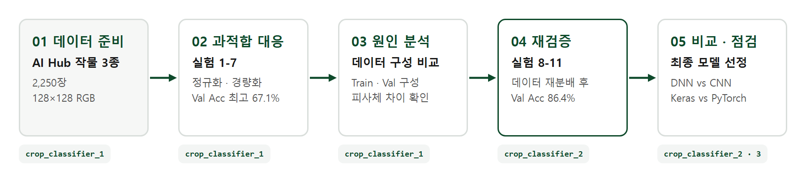

</div>

---

## 1. 프로젝트 개요

- **문제 정의:** CNN 기반 작물 3종(고추, 배추, 오이) 이미지 분류, 검증 정확도가 60%대에 정체되는 원인 분석
- **목표:** 과적합 진단 → 개선 → 원인 분석 → 모델 선택 과정을 통제된 실험 11회로 수행
- **기간:** 2026.09 – 2026.10
- **역할:** 개인 프로젝트 (데이터 준비, 모델 설계, 실험, 평가·분석)
- **규모:** 작물 3종 2,250장, 실험 11회
- **데이터:** AI Hub 「노지 작물 질병 진단 이미지」 중 고추·배추·오이 정상 이미지

| 영역 | 기술 | 활용 |
| --- | --- | --- |
| 딥러닝 | TensorFlow 2.21.0, Keras | CNN 설계·학습, 데이터 증강, Dropout, EarlyStopping |
| 딥러닝 | PyTorch 2.8.0 | 동일 CNN 구조 재구현, 학습 루프 직접 작성 |
| 평가·시각화 | scikit-learn, seaborn, matplotlib, PIL | 혼동 행렬, 클래스별 Precision·Recall·F1, 학습 곡선, 샘플 이미지 비교 |
| 개발 도구 | Jupyter Notebook, Git | 단계별 실험 노트북, 버전 관리 |

---

## 2. 핵심 역량

| 역량 | 수행 내용 | 근거 |
| --- | --- | --- |
| **과적합 진단** | Train·Validation 정확도 격차와 Validation Loss 추이를 기준으로 과적합 판단 | [4-1](#4-1-과적합-진단과-모델-경량화-실험-1-7) |
| **통제된 실험 설계** | 실험마다 한 가지 조건만 변경, 동일한 함수로 결과 기록 (실험 11회) | [5-1](#5-1-통제된-실험-설계) |
| **원인 분석** | 모델 조정으로 성능이 정체되자 학습·검증 데이터 구성을 직접 확인, 재분배 전후를 동일 모델로 비교 | [5-2](#5-2-원인-확인-후-조치) |
| **모델 경량화** | GAP 적용, 필터 축소로 파라미터 859,395 → 15,491개 | [4-1](#4-1-과적합-진단과-모델-경량화-실험-1-7) |
| **비교 실험** | DNN vs CNN, Keras vs PyTorch를 동일 데이터·구조로 비교 | [5-3](#5-3-비교-실험-조건-통일) |
| **추론 일관성 점검** | 학습과 예측의 전처리 불일치를 발견·통일, 혼동 행렬로 오분류 패턴 분석 | [5-4](#5-4-추론-일관성-점검) |

---

## 3. 분석 파이프라인과 데이터

| 노트북 | 내용 |
| --- | --- |
| [crop_classifier_1](notebooks/development/crop_classifier_1.ipynb) | 1부 데이터 준비·탐색, 실험 1-7, Training·Validation 구성 비교 |
| [crop_classifier_2](notebooks/development/crop_classifier_2.ipynb) | 2부 데이터 재분배·재검증(실험 8-11), 3부 DNN vs CNN |
| [crop_classifier_3](notebooks/development/crop_classifier_3.ipynb) | 4부 Keras vs PyTorch, 5부 최종 모델, 6부 예측 테스트·오분류 분석 |

**데이터 구성**

- 사용 데이터: 작물별 학습 600장, 검증 150장 무작위 추출 (Train 1,800 / Validation 450, `random.seed(42)`)
- 입력: 128×128 RGB, Batch Size 32

<p align="center">
  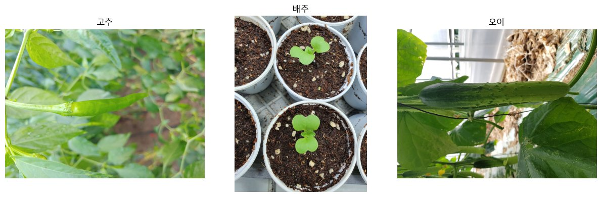
</p>

<details>
<summary>원본 데이터 규모</summary>

<br />

| 작물 | Training | Validation |
| --- | --- | --- |
| 고추 | 1,595 | 1,110 |
| 배추 | 825 | 1,183 |
| 오이 | 623 | 1,604 |

</details>

---

## 4. 주요 분석

### 4-1. 과적합 진단과 모델 경량화 (실험 1-7)

- **이유:** Baseline CNN에서 Train 정확도는 거의 1.0까지 오르지만 Validation 정확도는 60%대에 머물러, 과적합 원인과 대응 효과 확인 필요
- **과정:**
  - 정규화 기법 적용: Data Augmentation, Dropout 0.3 → 0.5, 두 기법 병행
  - 모델 경량화: 필터 수 축소와 GlobalAveragePooling 적용, 추가 단순화

<details>
<summary>정규화 실험 결과 (실험 1-4)</summary>

<br />

| 실험 | 변경 내용 | Train Acc | Val Acc |
| --- | --- | --- | --- |
| 1 | Baseline CNN (파라미터 859,395개) | 0.9994 | 0.6667 |
| 2 | + Data Augmentation | 0.9622 | 0.6511 |
| 3 | Dropout 0.3 → 0.5 | 0.9817 | 0.6711 |
| 4 | Data Augmentation + Dropout 0.5 | 0.9422 | 0.5756 |

</details>

| 실험 | 변경 내용 | 파라미터 | Val Acc | Val Loss |
| --- | --- | --- | --- | --- |
| 5 | 필터 축소 + GlobalAveragePooling | 15,491 | 0.6511 | 1.0065 |
| 6 | 실험 5 + Data Augmentation | 15,491 | 0.6222 | 1.0469 |
| 7 | 추가 단순화 (필터 16-16-16) | 5,411 | 0.6667 | 0.8253 |

- Acc = Accuracy, Val = Validation

<p align="center">
  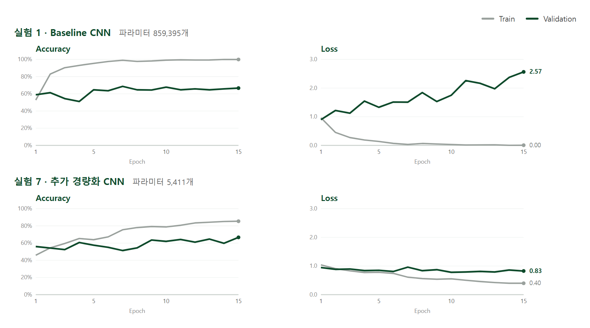
</p>

<p align="center">
  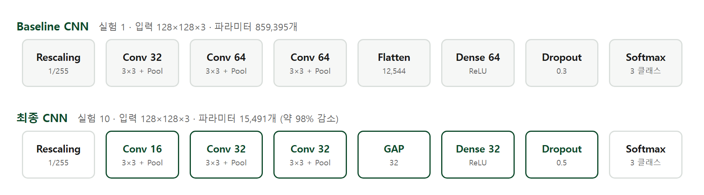
</p>

- **결과:**
  - Baseline: Train Acc 0.9994 대비 Val Acc 0.6667, Val Loss 0.8960 → 2.5658 증가로 과적합 판단
  - 정규화 기법은 일부 개선(실험 3)에 그쳤고, 두 기법 병행 시 오히려 하락(실험 4)
  - 경량화로 Train-Val 정확도 격차 33.27%p(실험 1) → 18.77%p(실험 7) 감소, Val Acc는 60%대 정체 → 모델 구조 외 요인 확인으로 전환

### 4-2. 데이터 구성 확인과 재분배 (실험 8-11)

- **이유:** 모델 구조를 단순화한 이후에도 Validation 정확도가 60%대에 머물러, 모델 외 요인(데이터 분할) 확인 필요
- **과정:**
  - 원본 Training·Validation 이미지를 작물별로 직접 샘플링하여 비교
  - 고추·오이: Training은 열매 중심, Validation은 잎·줄기·꽃 포함 / 배추: 어린 묘와 성장한 배추 등 생육 단계 차이
  - Training·Validation 통합 후 무작위 재분배, 동일 모델(실험 5 구조)로 재검증

<p align="center">
  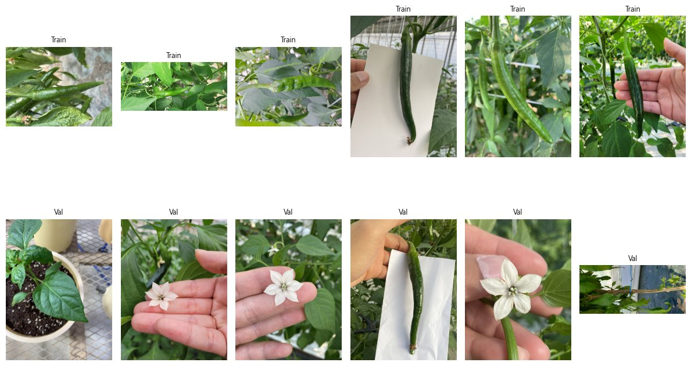
</p>

<p align="center">
  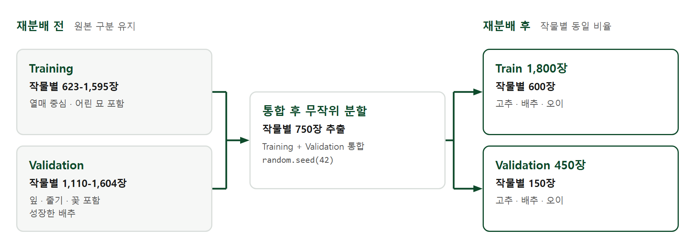
</p>

| 실험 | 조건 | Val Acc | Val Loss |
| --- | --- | --- | --- |
| 5 | 재분배 전 (필터 축소 + GAP) | 0.6511 | 1.0065 |
| 8 | 재분배 후, 실험 5와 동일 구조 | 0.7978 | 0.4490 |
| 9 | + Epoch 30 | 0.8267 | 0.4208 |
| **10** | **+ Epoch 50 (EarlyStopping) → 최종 모델** | **0.8644** | **0.3261** |
| 11 | 추가 단순화 (파라미터 5,411개) | 0.8267 | 0.4246 |

<p align="center">
  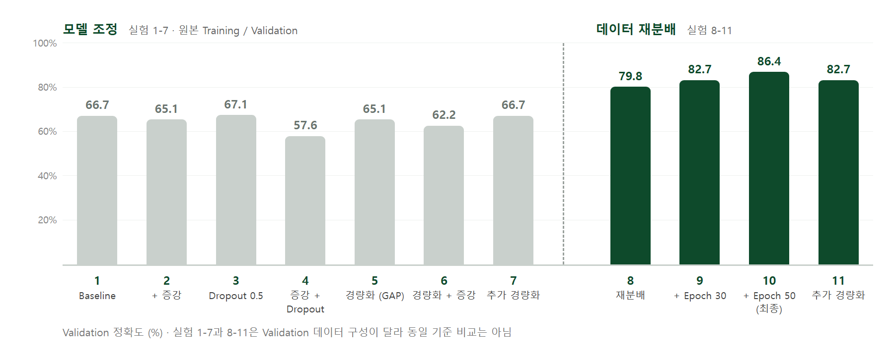
</p>

- **결과:**
  - 재분배 후 동일 모델에서 Val Acc 65.11 → 79.78%, Val Loss 1.0065 → 0.4490, Train-Val 격차 26.89 → 1.33%p로 개선
  - Epoch 50, EarlyStopping 적용 모델(실험 10, 파라미터 15,491개)이 Val Acc 86.44%로 최고, 최종 모델로 선정
  - 파라미터를 5,411개로 추가 경량화한 실험 11은 Val Acc 82.67%로 하락, 재분배 이후에는 격차가 이미 작아 추가 경량화 불필요

<details>
<summary>배추·오이 Training / Validation 비교</summary>

<br />

| 배추 | 오이 |
| --- | --- |
| 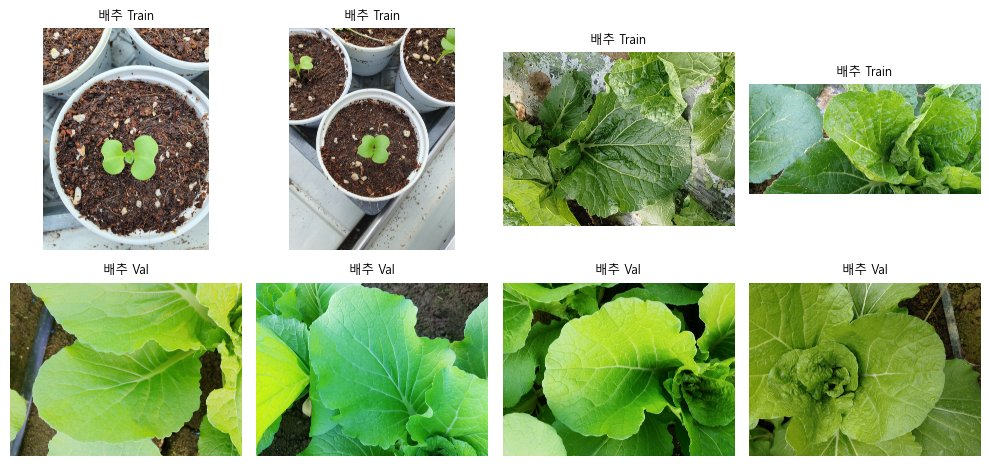 | 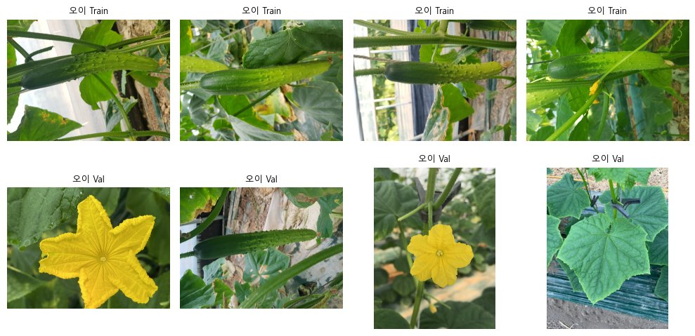 |

</details>

<details>
<summary>코드: Training·Validation 통합 후 재분배</summary>

<br />

[crop_classifier_2.ipynb](notebooks/development/crop_classifier_2.ipynb)

```python
random.seed(42)

for crop_kor, crop_eng in crop_map.items():
    train_files = [(f, train_folder) for f in os.listdir(train_folder)]
    val_files = [(f, val_folder) for f in os.listdir(val_folder)]

    all_files = train_files + val_files          # 원본 Training + Validation 통합
    random.shuffle(all_files)

    n_train = 600
    n_val = 150

    selected = random.sample(all_files, n_train + n_val)   # 작물별 750장 무작위 추출
    new_train = selected[:n_train]
    new_val = selected[n_train:]
    # (폴더 생성, 파일 복사, 출력 생략)
```

</details>

### 4-3. 모델 비교 (DNN vs CNN, Keras vs PyTorch)

- **이유:** 구조 차이(Flatten + Dense, Convolution)와 프레임워크 차이에 따른 성능·구현 차이 확인
- **과정:**
  - DNN vs CNN: 동일한 재분배 데이터로 DNN(Flatten + Dense)을 학습하여 CNN(실험 10)과 비교
  - Keras vs PyTorch: 동일 CNN 구조(파라미터 15,491개)를 PyTorch로 재구현, 학습 루프를 직접 작성

| 항목 | DNN (Flatten + Dense) | CNN (최종 모델) |
| --- | --- | --- |
| 파라미터 | 1,572,995 | 15,491 |
| Val Acc | 0.3333 | 0.8644 |
| Val Loss | 1.0986 | 0.3261 |

| 항목 | Keras | PyTorch |
| --- | --- | --- |
| Train Acc | 0.8722 | 0.8339 |
| Val Acc | 0.8644 | 0.8044 |
| Val Loss | 0.3261 | 0.4447 |
| CPU 학습 시간 | 약 21분 | 약 5시간 27분 |

- **결과:**
  - DNN은 CNN보다 약 101.5배 많은 파라미터를 사용했지만 Train·Val 정확도가 모두 약 33%(3클래스 무작위 수준)에 머묾
  - Keras vs PyTorch는 초기 가중치, 데이터 셔플, 학습 루프 차이가 있어 프레임워크 자체의 성능·속도 우위로 일반화하지 않음

<details>
<summary>코드: PyTorch 학습 루프와 EarlyStopping</summary>

<br />

[crop_classifier_3.ipynb](notebooks/development/crop_classifier_3.ipynb)

```python
for epoch in range(max_epochs):
    model_pt.train()
    for images, labels in train_loader_pt:
        optimizer.zero_grad()                   # 이전 Gradient 초기화
        outputs = model_pt(images)              # 순전파
        loss = criterion(outputs, labels)       # Loss 계산
        loss.backward()                         # 역전파
        optimizer.step()                        # 가중치 갱신

    model_pt.eval()
    with torch.no_grad():
        ...                                     # Validation Loss·Accuracy 계산

    if val_loss < best_val_loss:                # Validation Loss 기준 EarlyStopping
        best_val_loss = val_loss
        best_model_state = copy.deepcopy(model_pt.state_dict())
        patience_count = 0
    else:
        patience_count += 1
        if patience_count >= patience:
            break

model_pt.load_state_dict(best_model_state)      # 최저 Validation Loss 시점 가중치 복원
# (device 이동, Train 정확도 계산, 기록 저장 생략)
```

</details>

### 4-4. 최종 모델과 오분류 분석

- **이유:** 전체 정확도만으로 확인하기 어려운 클래스별 성능과 오분류 패턴 확인
- **과정:** 최종 모델(실험 10, 파라미터 15,491개)로 Validation 450장을 평가하고 혼동 행렬, 클래스별 Precision·Recall·F1 산출

| 클래스 | Precision | Recall | F1 |
| --- | --- | --- | --- |
| 배추 | 0.91 | 0.95 | 0.93 |
| 오이 | 0.85 | 0.75 | 0.80 |
| 고추 | 0.84 | 0.89 | 0.86 |

<p align="center">
  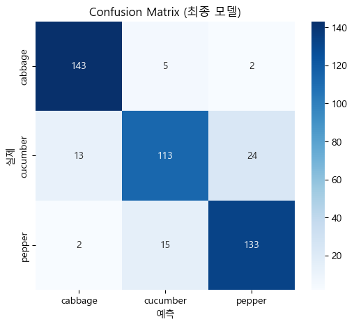
</p>

- **결과:**
  - Val Acc 86.44% (389 / 450), Train Acc 87.22%
  - 오분류가 가장 많은 방향: 오이 → 고추 24건, 반대 방향 고추 → 오이 15건 (오이 Recall 0.75로 최저)

<details>
<summary>최종 모델 학습 곡선</summary>

<br />

| Accuracy | Loss |
| --- | --- |
| 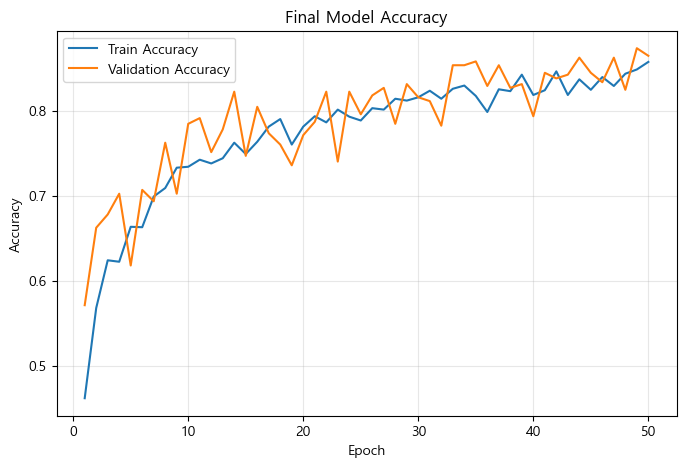 | 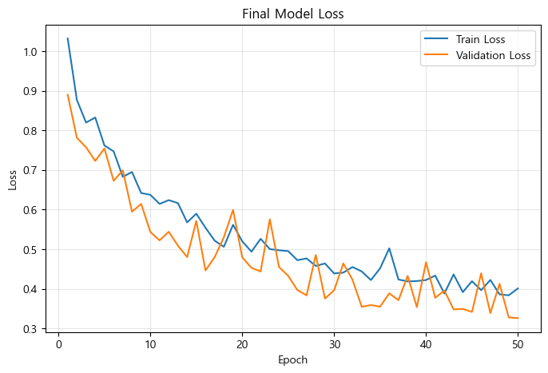 |

- Validation Loss가 Epoch 50까지 갱신되어 EarlyStopping 없이 50 Epoch 학습
- 학습 중 최고 Val Acc 0.8733(Epoch 49), 복원 모델 Val Acc 0.8644

</details>

---

## 5. 분석 설계와 검증

### 5-1. 통제된 실험 설계

- **문제:** 정규화, 경량화 등 여러 개선 방법을 시도하는 과정에서 어떤 변경이 성능에 영향을 주었는지 구분 필요
- **해결:** 실험마다 한 가지 조건만 변경하고, 동일한 `run_experiment` 함수로 Train·Val 정확도, Loss, 파라미터 수, 학습 시간 기록
- **결과:** 실험 11회를 같은 기준으로 비교

<details>
<summary>코드: 실험 결과 기록 함수</summary>

<br />

[crop_classifier_1.ipynb](notebooks/development/crop_classifier_1.ipynb)

```python
experiment_results = []

def run_experiment(name, model, train_ds, val_ds, epochs=15, verbose=1):
    start_time = time.time()
    history = model.fit(train_ds, validation_data=val_ds, epochs=epochs, verbose=verbose)
    elapsed = time.time() - start_time

    experiment_results.append({
        "실험명": name,
        "epochs": epochs,
        "총_파라미터": model.count_params(),
        "train_acc": round(history.history['accuracy'][-1], 4),
        "val_acc": round(history.history['val_accuracy'][-1], 4),
        "train_loss": round(history.history['loss'][-1], 4),
        "val_loss": round(history.history['val_loss'][-1], 4),
        "학습시간_초": round(elapsed, 1)
    })
    print(f"[기록 완료] {name}")
    return history
```

</details>

### 5-2. 원인 확인 후 조치

- **문제:** 샘플 이미지 비교만으로는 데이터 분할이 성능 저하의 원인이라고 단정할 수 없음
- **해결:** Training·Validation을 통합해 무작위로 재분배하고, 동일 모델(실험 5 구조)로 재학습하여 전후 비교
- **결과:** 재분배 후 Val Acc 65.11 → 79.78% (4-2 참고)

### 5-3. 비교 실험 조건 통일

- **문제:** DNN과 CNN, Keras와 PyTorch의 비교 결과에 데이터·학습 조건의 차이가 섞일 수 있음
- **해결:**
  - DNN vs CNN: 동일한 재분배 데이터와 학습 조건(EarlyStopping 포함) 사용
  - Keras vs PyTorch: 동일 구조(파라미터 15,491개), 입력 크기, Batch Size, Optimizer(Adam), 최대 Epoch(50) 적용
- **결과:** GPU 환경에서 학습 중 커널이 종료되어 PyTorch 비교는 CPU에서 수행, 학습 시간 차이를 프레임워크 자체의 속도 차이로 해석하지 않고 측정값으로만 기록

### 5-4. 추론 일관성 점검

- **문제:** 예측 테스트에서 배추 이미지가 오이 또는 고추로 반복 오분류
- **해결:** 예측 함수의 이미지 로딩(PIL `resize`)과 학습·평가의 로딩(Keras) 방식이 달라 같은 이미지의 픽셀 값이 다름을 확인(예: [42, 72, 14] vs [79, 105, 34]), `keras.utils.load_img(..., interpolation='bilinear')`로 통일
- **결과:** 통일 후 기존 오분류 배추 이미지 4장이 정상 분류(확신도 83-99%), 이후에도 일부 오분류가 남아 모델 자체의 한계로 보고 혼동 행렬로 추가 분석

<details>
<summary>코드: 전처리 불일치 확인과 예측 함수 통일</summary>

<br />

[crop_classifier_2.ipynb](notebooks/development/crop_classifier_2.ipynb), [crop_classifier_3.ipynb](notebooks/development/crop_classifier_3.ipynb)

```python
# 방법 1: PIL 방식 (기존 predict_image 함수)
img_pil = Image.open(img_path).convert('RGB').resize((IMG_SIZE, IMG_SIZE))
array_pil = np.array(img_pil)

# 방법 2: Keras 방식 (학습·평가용 데이터셋이 쓰는 방식)
img_tf = keras.utils.load_img(img_path, target_size=(IMG_SIZE, IMG_SIZE))
array_tf = keras.utils.img_to_array(img_tf)

print("두 배열이 완전히 같은가?", np.array_equal(array_pil, array_tf))   # 픽셀 값 차이 확인

def predict_image(image_path, model):
    img = keras.utils.load_img(
        image_path,
        target_size=(IMG_SIZE, IMG_SIZE),
        interpolation='bilinear'                # 학습·평가와 동일한 로딩 방식으로 통일
    )
    img_array = keras.utils.img_to_array(img)
    img_array = np.expand_dims(img_array, axis=0)
    prediction = model.predict(img_array, verbose=0)
    # (클래스명 변환, 확신도 계산, 시각화 생략)
```

</details>

---

## 6. 한계와 개선 방향

- **데이터 구성:** 재분배 전후 Validation 데이터 구성이 달라 정확도를 동일 기준으로 비교할 수 없음
- **평가 방식:** 별도의 테스트 데이터 없이 Validation 데이터로 모델 선택과 최종 평가를 함께 수행, 테스트 데이터 분리 필요
- **데이터 규모:** 작물별 750장만 사용하여 원본 데이터의 일부만 반영
- **오분류 원인:** 오이·고추 간 혼동 원인(잎 모양, 촬영 구도 등) 미확인, 오분류 이미지 분석 필요

---

<details>
<summary><b>실행 방법과 폴더 구조</b></summary>

<br />

**데이터 준비**

- AI Hub에서 「노지 작물 질병 진단 이미지」를 내려받아 `data/raw`에 저장
- 노트북의 데이터·모델 경로가 개인 PC 절대 경로로 되어 있어, 실행 전 각 노트북의 경로를 환경에 맞게 변경

**실행 순서**

- `crop_classifier_1` → `crop_classifier_2` → `crop_classifier_3`

```text
crop-image-classification/
├── notebooks/
│   └── development/
│       ├── crop_classifier_1.ipynb   # 1부, 실험 1-7
│       ├── crop_classifier_2.ipynb   # 2-3부, 실험 8-11, DNN vs CNN
│       └── crop_classifier_3.ipynb   # 4-6부, 최종 모델, 전체 결론
├── docs/
│   └── diagrams/                     # README 도식 원본(diagrams.html), 렌더 스크립트(render.ps1)
├── images/                           # README용 그래프, 도식
└── README.md
```

</details>

---

## 7. 프로젝트를 통해 얻은 교훈

- **정규화 기법의 단독 효과 확인:** Dropout 강화는 일부 개선(Val Acc 0.6667 → 0.6711), 두 기법 병행은 하락(0.5756)하여 조합 전에 단독 효과 확인 필요
- **정체 구간에서 원인 범위 확장:** 모델 구조를 바꿔도 Val Acc가 60%대에 머물자 Training·Validation 이미지를 직접 비교하고 재분배하여 동일 모델 기준 65.11 → 79.78% 개선
- **경량화의 적정 수준:** 파라미터 859,395 → 15,491개 경량화는 과적합 완화에 효과적이었으나, 재분배 이후 5,411개로 추가 경량화 시 Val Acc가 86.44 → 82.67%로 하락
- **비교 결과의 해석 범위:** 동일 CNN 구조를 Keras와 PyTorch(학습 루프 직접 작성)로 비교했으나, PyTorch가 CPU에서 실행되어 학습 시간(약 21분 vs 약 5시간 27분)을 프레임워크 우열로 일반화할 수 없음을 확인
- **학습과 추론의 전처리 일치:** Keras와 PIL의 이미지 로딩 방식 차이로 같은 이미지의 픽셀 값이 달라지는 문제를 발견·통일, 통일 후 남은 오분류는 혼동 행렬로 분석 (오이 → 고추 24건)
- **평가 방식의 한계 인식:** 별도 테스트 데이터 없이 Validation 데이터로 모델 선택과 최종 평가를 함께 수행하여, 테스트 데이터를 분리한 평가 구조의 필요성 확인

---

<div align="center">

### 이미지 분류 · 딥러닝 프로젝트

**작물 이미지 분류 (CNN)**

</div>
